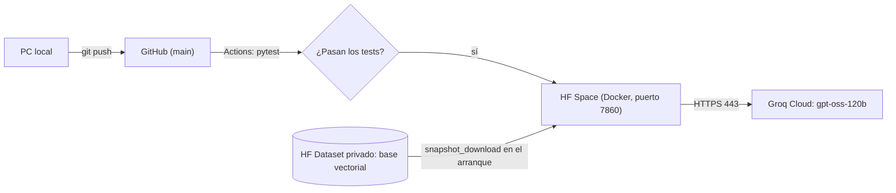

# Guía paso a paso: puesta en producción de Tech Tutor Engine

Despliegue del motor MaaS (FastAPI + faster-whisper + ChromaDB + Groq `gpt-oss-120b`) en **Hugging Face Spaces (Docker)** con integración continua desde **GitHub Actions**.

> **Convención:** sustituya `TU_USUARIO_HF`, `TU_SPACE`, `TU_USUARIO_GH` por sus valores reales. En el código y la especificación aparece `leonardo-beltran` como usuario de Hugging Face; si su usuario real es otro, úselo en todos los pasos y en la variable `CORPUS_DATASET_REPO`.



---

## Fase 0 · Requisitos previos

| Necesita | Para qué | Dónde |
|---|---|---|
| Cuenta de **GitHub** | Repositorio y CI/CD | github.com |
| Cuenta de **Hugging Face** | Space + Dataset de la base vectorial | huggingface.co |
| **Groq API key** con acceso a `openai/gpt-oss-120b` | Motor de razonamiento | console.groq.com/keys |
| Git, Python 3.11/3.12 | Trabajo local | — |
| La **base vectorial real** (213,439 vectores) | RAG | Su equipo (ver Fase 3) |

Instale el cliente de Hugging Face: `pip install -U huggingface_hub` (proporciona el comando `hf`).

---

## Fase 1 · Seguridad de credenciales (hágalo primero)

> [!CAUTION]
> El token `D1mZjn…` aparecía como valor por defecto en el código (`config.py`, ya presente en commits anteriores) y en la especificación y el README. Considérelo **comprometido**: no lo reutilice en producción.

1. Genere un token nuevo para la API:
   ```bash
   python -c "import secrets; print(secrets.token_urlsafe(32))"
   ```
   Guárdelo en un gestor de contraseñas; será su `API_TOKEN` de producción.
2. Si su `GROQ_API_KEY` se ha compartido en algún chat, captura o repositorio, revóquela y cree otra en la consola de Groq.
3. Verifique que `.env` **no** esté versionado:
   ```bash
   git ls-files .env      # no debe imprimir nada
   git status --short     # .env no debe aparecer
   ```

---

## Fase 2 · Validación local

```bash
python -m venv .venv
.venv\Scripts\activate                      # Linux/macOS: source .venv/bin/activate
pip install -r requirements-dev.txt
pytest -v                                   # debe terminar en verde (sin red ni modelos)
```

Arranque real (requiere `.env` con `GROQ_API_KEY` y `API_AUTH_TOKEN`):

```bash
python -m uvicorn app.main:app --port 8000
curl http://localhost:8000/health -H "Authorization: Bearer <API_AUTH_TOKEN>"
```

Resultado esperado: `"status":"ok"` con `chroma_ready`, `asr_ready` y `llm_configured` en `true`.
Si `status` es `degraded`, revise los logs antes de continuar.

---

## Fase 3 · Publicar la base vectorial como Dataset privado

La base (~213 k vectores) no cabe en Git; el contenedor la descarga al arrancar (`app/services/corpus_sync.py`).

> [!IMPORTANT]
> En este equipo, `data/technical_corpus_db/` contiene solo ~200 KB (el corpus mínimo de 5 documentos que el servicio crea cuando la colección está vacía). **Localice la carpeta del corpus completo** (la generada al indexar los 31 repositorios) y compruebe su tamaño antes de subirla:
> ```bash
> python -c "import chromadb; c=chromadb.PersistentClient(path=r'RUTA/AL/corpus').get_collection('tech_tutor_corpus'); print(c.count())"
> ```
> Debe imprimir `213439`. La versión de `chromadb` de la imagen (`>=1.5,<2`) debe ser la misma **major** con la que se creó la base.

1. Cree un token en <https://huggingface.co/settings/tokens>:
   - **Token A (write)** – para subir el dataset y para el CI (Fase 6).
   - **Token B (read, fine-grained, solo el dataset)** – para el Space (Fase 5).
2. Inicie sesión y cree el dataset privado:
   ```bash
   hf auth login                                   # pegue el Token A
   hf repo create TU_USUARIO_HF/tech-tutor-corpus --repo-type dataset --private
   ```
3. Suba el **contenido** de la carpeta en la raíz del dataset (debe quedar `chroma.sqlite3` y la carpeta UUID en la raíz):
   ```bash
   hf upload TU_USUARIO_HF/tech-tutor-corpus "RUTA/AL/corpus" . --repo-type dataset
   ```
4. En la pestaña *Files* del dataset compruebe que `chroma.sqlite3` está en la raíz.

---

## Fase 4 · Crear el Space de Hugging Face

1. <https://huggingface.co/new-space> → **Name:** `tech-tutor-engine` (o el que prefiera) · **SDK:** `Docker` → *Blank* · **Hardware:** `CPU basic` (2 vCPU / 16 GB RAM) para empezar.
2. **Visibilidad:** use **Public**. La API sigue protegida por su token Bearer.
   > Con un Space *privado*, el proxy de Hugging Face exige **su** token HF en la cabecera `Authorization`. En ese caso envíe el token de la API en `X-API-Key` (la API lo acepta) y el token HF en `Authorization`.
3. La URL pública será `https://TU_USUARIO_HF-TU_SPACE.hf.space` (minúsculas, guiones).

---

## Fase 5 · Secretos y variables del Space

En el Space → **Settings → Variables and secrets**:

| Tipo | Nombre | Valor |
|---|---|---|
| **Secret** | `GROQ_API_KEY` | su clave de Groq |
| **Secret** | `API_TOKEN` | el token generado en la Fase 1 |
| **Secret** | `HF_TOKEN` | Token B (read) del dataset |
| Variable | `CORPUS_DATASET_REPO` | `TU_USUARIO_HF/tech-tutor-corpus` |
| Variable | `ENVIRONMENT` | `production` |
| Variable | `ALLOWED_ORIGINS` | `["*"]` o la lista de dominios autorizados |

> `API_TOKEN` es alias de `API_AUTH_TOKEN`; ambos nombres funcionan. No hay token por defecto: si no lo define, todas las peticiones devuelven 401.

---

## Fase 6 · Subir el código a GitHub

> El remoto actual de este repositorio es `https://github.com/leo7leoavil-ship-it/tech_tutor_engine.git`. La especificación menciona `tech_tutor_engine_V2`; use el que desee (cree uno nuevo vacío si prefiere V2 y cambie el remoto con `git remote set-url origin <url>`).

```bash
git status                                  # revise: no debe aparecer .env ni data/technical_corpus_db/*
git add app/ tests/ scripts/ .github/ data/.gitkeep Dockerfile .dockerignore .gitignore \
        .env.example pytest.ini requirements.txt requirements-dev.txt README.md \
        GUIA_DESPLIEGUE_PRODUCCION.md
git commit -m "feat(core): MaaS production release with gpt-oss-120b, WebSocket and Docker deployment"
git branch -M main
git push -u origin main
```

---

## Fase 7 · Despliegue automático (GitHub Actions → Hugging Face)

1. En GitHub → *Settings → Secrets and variables → Actions*:
   - **Secret** `HF_TOKEN` = Token A (**write**).
   - **Variables** `HF_USERNAME` = `TU_USUARIO_HF` y `HF_SPACE_NAME` = `tech-tutor-engine` (o su nombre).
2. Cada `push` a `main` ejecuta `.github/workflows/deploy.yml`:
   1. `test`: instala dependencias y ejecuta `pytest -v`.
   2. `deploy` (solo si los tests pasan): hace `git push --force` del commit al Space.
3. Primer despliegue manual alternativo (si prefiere no esperar al CI):
   ```bash
   git remote add space https://TU_USUARIO_HF:<TOKEN_A>@huggingface.co/spaces/TU_USUARIO_HF/TU_SPACE
   git push --force space main
   git remote remove space        # no deje el token guardado en la configuración
   ```

> [!WARNING]
> `--force` reemplaza el historial del Space con el de GitHub. Es lo esperado (GitHub es la fuente de verdad); no edite archivos directamente en el Space.

---

## Fase 8 · Construcción y primer arranque

1. En el Space, pestaña **Logs**:
   - **Build (≈10–20 min la primera vez):** instala dependencias y descarga `large-v3-turbo` y `all-MiniLM-L6-v2` dentro de la imagen.
   - **Arranque:** busque en orden estas líneas:
     ```
     Vector DB missing. Downloading dataset 'TU_USUARIO_HF/tech-tutor-corpus' ...
     Vector DB downloaded successfully.
     ChromaDB connected successfully. Collection 'tech_tutor_corpus' contains 213439 documents.
     faster-whisper 'large-v3-turbo' model loaded successfully.
     All AI pipelines preloaded in memory. System ready for inference.
     ```
2. El estado del Space pasa a **Running**. La descarga del corpus se repite en cada reinicio (el disco del contenedor es efímero).

---

## Fase 9 · Verificación en producción

```bash
export URL=https://TU_USUARIO_HF-TU_SPACE.hf.space
export TOKEN=<API_TOKEN>
```
(En PowerShell: `$env:URL="..."; $env:TOKEN="..."` y use `$env:TOKEN` en los comandos.)

| # | Prueba | Comando | Esperado |
|---|---|---|---|
| 1 | Swagger | abrir `$URL/docs` | página OpenAPI |
| 2 | Sin token | `curl -i $URL/health` | `401` |
| 3 | Salud | `curl $URL/health -H "Authorization: Bearer $TOKEN"` | `"status":"ok"`, 3 banderas `true` |
| 4 | RAG | `curl -X POST $URL/api/v1/query -H "Authorization: Bearer $TOKEN" -H "Content-Type: application/json" -d '{"query_text":"How does horizontal database sharding mitigate write bottleneck?","top_k":3}'` | 3 `chunks` con `distance` y `source` |
| 5 | Texto | `curl -X POST $URL/api/v1/evaluate/text -H "Authorization: Bearer $TOKEN" -H "Content-Type: application/json" -d '{"candidate_text":"We shard the database to reduce write latency.","target_scenario":"system_design_interview"}'` | `200`, `cefr_level`, `detected_technical_terms` |
| 6 | Voz | `curl -X POST $URL/api/v1/evaluate/voice -H "Authorization: Bearer $TOKEN" -F "audio_file=@sample.wav" -F "target_scenario=system_design_interview"` | `200` con `asr_metrics` y `evaluation_core` |
| 7 | WER | igual que 6 añadiendo `-F "expected_transcript=<texto leído>"` | `asr_metrics.wer_score` numérico |

Prueba del WebSocket (`pip install websockets`):

```python
import asyncio, json, websockets

async def main():
    uri = "wss://TU_USUARIO_HF-TU_SPACE.hf.space/api/v1/ws/practice?token=<API_TOKEN>"
    async with websockets.connect(uri, max_size=None) as ws:
        print(await ws.recv())                                   # {"event": "ready"}
        await ws.send(json.dumps({"action": "config", "target_scenario": "system_design_interview"}))
        await ws.send(open("sample.webm", "rb").read())
        await ws.send(json.dumps({"action": "end"}))
        while True:
            msg = json.loads(await ws.recv())
            print(msg["event"])
            if msg["event"] in ("completed", "error"):
                print(json.dumps(msg, indent=2)); break

asyncio.run(main())
```
Eventos esperados: `ready → transcribing → retrieving → evaluating → completed`.

---

## Fase 10 · Evidencia para la defensa (benchmarks)

Ejecútelos en su equipo (con `.env` y el corpus real) o dentro del Space si dispone de acceso a su terminal:

```bash
python tests/benchmark_thesis.py wer     --audio-dir benchmark_data/audio       # 50 audios + .txt de referencia
python tests/benchmark_thesis.py rag     --queries benchmark_data/queries.json  # 100 consultas canónicas
python tests/benchmark_thesis.py latency --audio benchmark_data/audio/sample.wav --runs 20
```

Formato de `queries.json`: `[{"query": "...", "relevant_sources": ["sharding.md", "system-design-primer"]}]`.
Los informes quedan en `benchmark_results/` (JSON). Metas: **WER < 12 %**, **Recall@3 ≥ 85 %**, **latencia < 2.5 s**.

> [!NOTE]
> `CPU basic` (2 vCPU) puede tardar varios segundos en transcribir con `large-v3-turbo`. Mida la latencia **en el Space**; si excede el objetivo, suba el hardware (*Settings → Space hardware*) y documente ambas configuraciones en el capítulo de resultados.

---

## Solución de problemas

| Síntoma | Causa probable | Solución |
|---|---|---|
| Space en *Configuration error* | Falta el bloque YAML del `README.md` | No elimine el front matter (`sdk: docker`, `app_port: 7860`) |
| `401 Unauthorized` con el token correcto | `API_TOKEN` no definido o con espacios; Space privado | Revise el secreto; use `X-API-Key` si el Space es privado |
| `/health` → `degraded`, `chroma_ready:false` | Falló la descarga del dataset | Revise `HF_TOKEN` (read), `CORPUS_DATASET_REPO` y que `chroma.sqlite3` esté en la raíz del dataset |
| Colección con solo 5 documentos | Se creó la base mínima porque no había corpus | Corrija la Fase 3 y reinicie el Space (*Settings → Factory reboot*) |
| `llm_configured:false` / `502` en evaluaciones | `GROQ_API_KEY` ausente o sin acceso al modelo; cuota agotada | Revise el secreto y los límites en la consola de Groq |
| `422 Audio decoding error` | Audio corrupto o formato no soportado | Use `.wav/.mp3/.webm/.ogg/.m4a` válidos |
| `413` | Audio > 25 MB | Aumente `MAX_AUDIO_BYTES` o comprima el audio |
| Build falla por memoria/tiempo | Descarga de modelos | *Factory rebuild*; revise los logs del paso `RUN python3 -c ...` |
| El deploy de Actions falla con `403` | `HF_TOKEN` sin permiso de escritura o variables vacías | Recree el Token A (write) y defina `HF_USERNAME`/`HF_SPACE_NAME` |
| Chroma: error de esquema/versión | Base creada con otra major de chromadb | Reindexe con la versión fijada en `requirements.txt` |

---

## Operación posterior

- **Actualizar:** haga `git push` a `main`; el CI vuelve a probar y desplegar.
- **Rotar el token de la API:** cambie el secreto `API_TOKEN` en el Space (se reinicia solo) y avise a los clientes.
- **Inactividad:** los Spaces gratuitos se duermen tras un periodo sin tráfico; la primera petición los despierta (tarda lo que dure el arranque y la descarga del corpus). Antes de la defensa, ábralo con antelación o considere hardware mejorado.
- **Rollback:** `git revert <commit>` y `git push`; o *Settings → Factory reboot* para repetir el despliegue actual.
- **Costos:** Groq y Hugging Face aplican límites/cuotas; revise ambos paneles antes de sesiones de benchmark intensivas.

---

## Lista de verificación final

- [ ] Token de API nuevo generado; claves comprometidas revocadas
- [ ] `pytest -v` en verde localmente y en GitHub Actions
- [ ] Dataset privado con `chroma.sqlite3` en la raíz y 213 439 vectores confirmados
- [ ] Space creado (Docker) con secretos `GROQ_API_KEY`, `API_TOKEN`, `HF_TOKEN` y variable `CORPUS_DATASET_REPO`
- [ ] Secreto `HF_TOKEN` y variables `HF_USERNAME`/`HF_SPACE_NAME` en GitHub
- [ ] `/health` → `ok` en el Space; pruebas 1–7 y WebSocket superadas
- [ ] Benchmarks ejecutados y reportes archivados para la tesis
