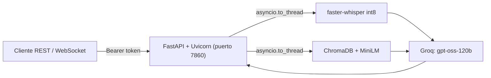

# Tech Tutor Engine

**Asistente de Inteligencia Artificial Especializado en Inglés Técnico para Ingenieros del Área de Tecnología**  
*Proyecto de Titulación - Ingeniería en Computación · Universidad Autónoma de Tlaxcala*

> El bloque YAML superior es la configuración del Space de Hugging Face (`sdk: docker`, `app_port: 7860`). **No lo elimine**: sin él, el Space no arranca.

---

## 1. Visión General

`tech-tutor-engine` es un **Motor de Inferencia y Evaluación Técnica Asíncrono (Model-as-a-Service)** que diagnostica y puntúa la competencia en **inglés técnico** de ingenieros de software. Expone una API REST y un canal WebSocket (sin interfaz gráfica propia; el frontend queda como Trabajo Futuro) sobre **FastAPI** y tres pipelines de IA:

1. **ASR:** `faster-whisper` (`large-v3-turbo`, CPU `int8`) sobre `io.BytesIO`, con `initial_prompt` léxico técnico y métricas de confianza, WPM y WER/CER (`jiwer`) opcionales.
2. **RAG:** `ChromaDB` (`tech_tutor_corpus`, ~213 439 vectores, `all-MiniLM-L6-v2`, coseno) con sanitización regex post-recuperación y fusión `"{escenario}: {texto}"`.
3. **LLM:** `openai/gpt-oss-120b` en **Groq Cloud** (`temperature=0.1`, Structured Outputs) bajo rúbricas MCER/CEFR. La densidad léxica se calcula de forma **determinista en Python**, no por el LLM.



---

## 2. Estructura del Repositorio

```
tech_tutor_engine/
├── .github/workflows/deploy.yml   # CI (pytest) + despliegue a Hugging Face Spaces
├── app/
│   ├── main.py                    # Lifespan (descarga de corpus + precarga), CORS, rutas
│   ├── core/                      # config.py, security.py, logging.py
│   ├── api/v1/
│   │   ├── router.py
│   │   └── endpoints/             # health, query, evaluate, websocket
│   ├── services/                  # asr_service, rag_service, llm_service,
│   │                              # evaluation_pipeline, corpus_sync
│   ├── schemas/                   # request_schemas, response_schemas (Pydantic v2)
│   └── ui/gradio_app.py           # Sandbox OPCIONAL (ENABLE_UI=true)
├── data/                          # Base vectorial local (ignorada por Git)
├── scripts/                       # run_server.py, seed_corpus.py
├── tests/                         # test_api/asr/rag/llm/config/schemas + benchmark_thesis.py
├── Dockerfile                     # Multi-stage, ffmpeg, pre-descarga de pesos
├── requirements.txt / requirements-dev.txt
├── .env.example · .dockerignore · .gitignore · pytest.ini
└── GUIA_DESPLIEGUE_PRODUCCION.md  # Paso a paso hacia producción
```

---

## 3. Ejecución Local

```bash
python -m venv .venv && .venv\Scripts\activate        # Windows (Linux/macOS: source .venv/bin/activate)
pip install -r requirements-dev.txt
cp .env.example .env                                   # y complete GROQ_API_KEY y API_AUTH_TOKEN
python -m uvicorn app.main:app --host 0.0.0.0 --port 8000
```

Requiere **ffmpeg** en el `PATH` si se procesan contenedores comprimidos fuera de Docker. Swagger: `http://localhost:8000/docs`.

### Variables de entorno principales

| Variable (alias) | Descripción |
|---|---|
| `GROQ_API_KEY` | Clave de Groq Cloud (secreto) |
| `API_AUTH_TOKEN` (`API_TOKEN`) | Token Bearer/`X-API-Key`. **Sin valor por defecto**: si está vacío, toda petición recibe 401 |
| `LLM_MODEL` (`LLM_MODEL_NAME`) | `openai/gpt-oss-120b` |
| `ASR_MODEL_NAME` (`WHISPER_MODEL_NAME`) | `large-v3-turbo` |
| `CHROMA_PERSIST_DIRECTORY` (`CHROMA_PERSIST_DIR`) | `./data/technical_corpus_db` |
| `CORPUS_DATASET_REPO` / `HF_TOKEN` | Dataset del Hub del que se descarga la base vectorial si falta |
| `ENABLE_UI` | `true` monta el sandbox Gradio en `/ui` (requiere `pip install gradio`) |

Lista completa en [`.env.example`](.env.example).

---

## 4. API

Todas las rutas requieren `Authorization: Bearer <API_AUTH_TOKEN>` (o `X-API-Key`), salvo `GET /` y `/docs`.

| Método | Ruta | Descripción |
|---|---|---|
| `GET` | `/health` · `/api/v1/health` | Estado: `status`, `app`, `version`, `chroma_ready`, `asr_ready`, `llm_configured` |
| `POST` | `/api/v1/query` | Búsqueda semántica directa: `{"query_text": "...", "top_k": 3}` |
| `POST` | `/api/v1/evaluate/voice` | `multipart/form-data`: `audio_file`, `target_scenario`, `expected_transcript` (opcional) |
| `POST` | `/api/v1/evaluate/text` | `{"candidate_text": "...", "target_scenario": "..."}` |
| `WS` | `/api/v1/ws/practice` | Streaming de audio con eventos de progreso |

**Escenarios:** `system_design_interview`, `code_review`, `incident_postmortem`, `architecture_presentation` (las etiquetas anteriores `System Design`, `Code Review`, `Thesis Defense` se siguen aceptando).

**Códigos de error:** `400` formato no soportado/archivo vacío · `401` token inválido · `413` audio demasiado grande · `422` escenario desconocido, audio ilegible o sin habla · `502` fallo del motor LLM · `503` ASR no cargado.

```bash
curl -X GET  "$URL/health" -H "Authorization: Bearer $API_TOKEN"

curl -X POST "$URL/api/v1/evaluate/voice" -H "Authorization: Bearer $API_TOKEN" \
  -F "audio_file=@sample.wav" -F "target_scenario=system_design_interview"

curl -X POST "$URL/api/v1/evaluate/text" -H "Authorization: Bearer $API_TOKEN" \
  -H "Content-Type: application/json" \
  -d '{"candidate_text":"We shard the database to reduce write latency.","target_scenario":"system_design_interview"}'
```

### Protocolo WebSocket

Conexión: `wss://<host>/api/v1/ws/practice?token=<API_TOKEN>` (o cabecera `Authorization`).

| Dirección | Mensaje |
|---|---|
| cliente → servidor | `{"action":"config","target_scenario":"code_review","format":"webm","expected_transcript":"..."}` (opcional; `format` = `webm` \| `pcm16` + `sample_rate`) |
| cliente → servidor | tramas **binarias** con el audio |
| cliente → servidor | `{"action":"end"}` procesa la locución · `{"action":"reset"}` descarta el buffer |
| servidor → cliente | `{"event":"ready"}` → `transcribing` → `retrieving` (`partial_text`) → `evaluating` → `completed` (`payload` = `EvaluationResponse`) |
| servidor → cliente | `{"event":"error","status_code":..,"detail":".."}` (la conexión sigue abierta) |

---

## 5. Rúbricas MCER / CEFR

| Nivel | Descriptor técnico | Criterio |
|---|---|---|
| **B1** | Umbral | Idea principal con estructuras simples y vocabulario genérico |
| **B2** | Usuario independiente | Conceptos claros con frases coloquiales (*"we put a cache"*) |
| **C1** | Competencia operativa eficaz | Terminología precisa y estructuras complejas (*"mitigate read latency"*) |
| **C2** | Maestría | Dicción idiomática impecable y precisión conceptual total |

---

## 6. Pruebas y Benchmarks

```bash
pytest -v                                   # Suite con dobles de prueba: sin red, sin modelos
python tests/benchmark_thesis.py wer     --audio-dir benchmark_data/audio
python tests/benchmark_thesis.py rag     --queries benchmark_data/queries.json --ks 3 5
python tests/benchmark_thesis.py latency --audio benchmark_data/audio/sample.wav --runs 10
```

Objetivos de la tesis: **WER < 12 %**, **Recall@3 ≥ 85 %**, **latencia total < 2.5 s**.

---

## 7. Despliegue en Producción

Consulte la guía paso a paso en [`GUIA_DESPLIEGUE_PRODUCCION.md`](GUIA_DESPLIEGUE_PRODUCCION.md).
